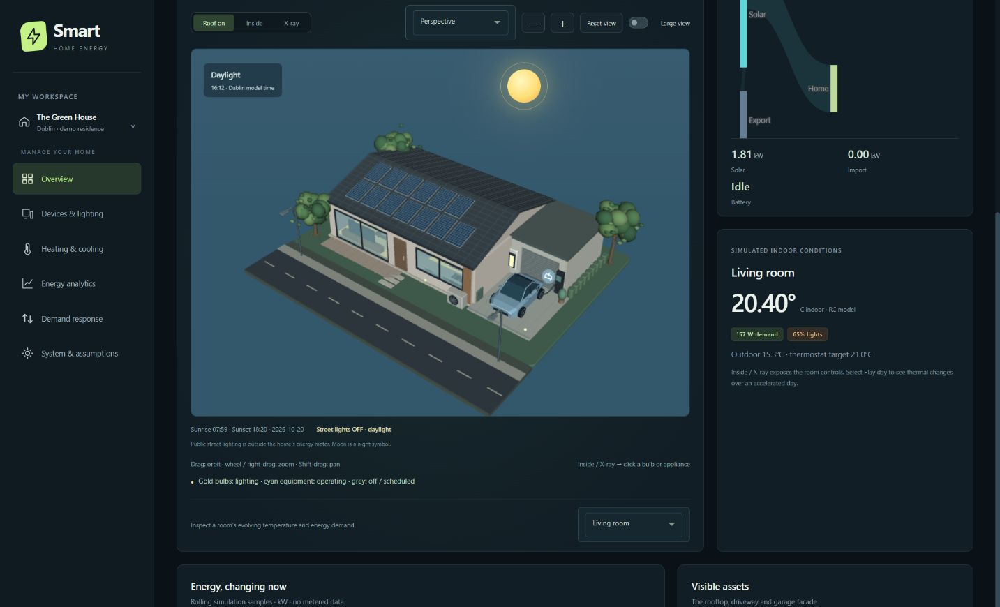
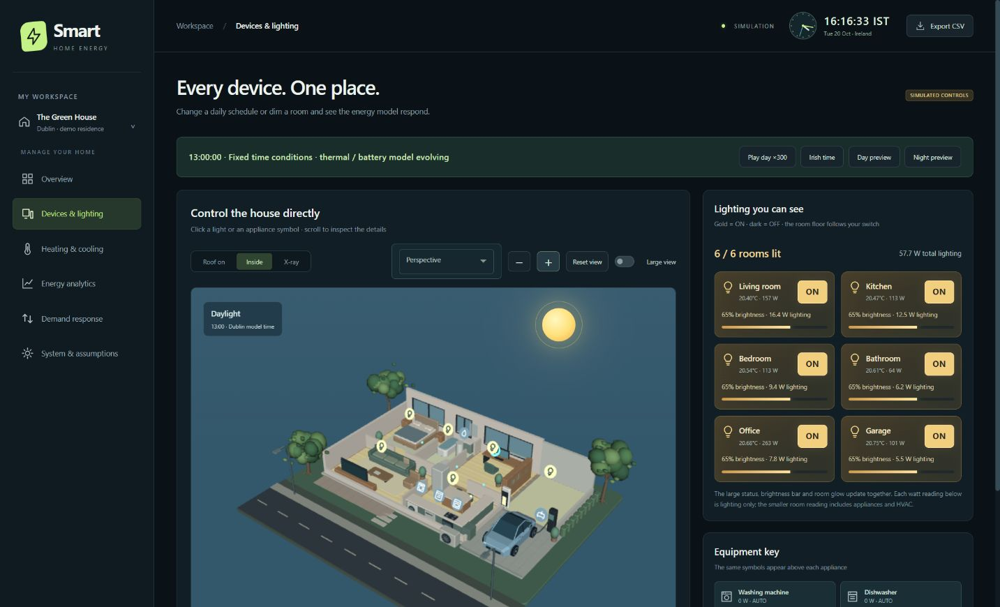

# Smart — Smart Home Energy Management

A complete, Python-authored Dash application for an examiner-facing smart-home energy demonstration. The interface, Plotly analytics, VTK WebGL house, callbacks, scheduling and energy calculations are authored in Python. Local CSS supplies the visual theme; there is no handwritten application JavaScript or separate frontend build.

[Live dashboard](https://behnamproject-smarthome.onrender.com/) · [Source repository](https://github.com/BehnamMohseniGharyehsafa/verdant-home-energy) · [Deploy another instance](https://render.com/deploy?repo=https://github.com/BehnamMohseniGharyehsafa/verdant-home-energy)

**Share the live dashboard directly:** visitors need no Render/GitHub account or Python installation, and your own computer can be turned off. The Free Render instance may take about a minute to wake after inactivity; allow additional time for the initial 3D assets to load. A modern browser with WebGL support is needed for the house.

**Data and controls are simulated.** The app does not claim to be connected to meters, appliances, electricity markets, a real demand-response program or an AI service. It works without API keys or personal home data.





[Night lighting preview](docs/images/night.jpg) · [Grid-connected demand response](docs/images/demand-response.jpg) · [Response analytics](docs/images/demand-response-analytics.jpg)

Documentation: [examiner walkthrough](EXAMINER_GUIDE.md) · [architecture](docs/ARCHITECTURE.md) · [CSV data dictionary](docs/DATA_DICTIONARY.md) · [verification record](docs/VERIFICATION.md) · [contributing](CONTRIBUTING.md) · [security scope](SECURITY.md).

The interface is branded **Smart**. The source repository remains `verdant-home-energy`; the Render Blueprint requests the service name `behnamproject-smarthome`.

## Run locally

Python **3.13.7** is the pinned deployment runtime. Python 3.11–3.13 should support the source, but only the pinned runtime has been checked here. A WebGL-capable modern desktop browser is needed for the 3D home.

From this project folder, on Windows PowerShell:

```powershell
python -m venv .venv
.\.venv\Scripts\python.exe -m pip install -r requirements.txt
.\.venv\Scripts\python.exe app.py
```

Open **http://127.0.0.1:8050/**. Keep the terminal running. This local URL cannot be used by your examiner on another computer. If the port is occupied, set `$env:PORT = '8051'` before starting and use that port in the browser.

**Updating an already running copy:** press **Ctrl+C** in its terminal, run `.\.venv\Scripts\python.exe -m pip install -r requirements.txt`, then run `.\.venv\Scripts\python.exe app.py` again. Reload the browser with **Ctrl+F5**. The renderer requires the pinned Dash/React combination; do not independently upgrade Dash.

On **Overview**, use **Roof on**, **Inside** or **X-ray**. Drag to orbit, use the wheel or right-drag to zoom, or use the **+ / −** buttons. **Reset view**, camera presets and **Large view** help inspect details. On **Devices & lighting**, click a gold bulb to switch that room off/on; click an appliance symbol to apply a live override. Matching symbols and accessible buttons appear alongside the house.

The header clock always shows actual **Irish local time**. **Irish time** follows that time in the simulation; **Play day ×300** makes one model day take about 4 minutes 48 seconds. Watch room temperatures, solar, battery, live power and energy-flow particles change. **Inspect time** enables the quarter-hour slider. All these readings remain simulated.

**Day, night and lighting:** the house viewers show the sun during calculated Dublin daylight and a moon/stars after sunset. Their background and building illumination change, and the two public streetlights switch on automatically. Devices provides **Day preview** (13:00), **Night preview** (21:00) and **Irish time** buttons. Gold ON tiles, dark OFF tiles, brightness bars, lighting-only watts and whole-room floor glow make each switch visible. Trees have branching trunks and irregular foliage, and the EV uses a fastback body, panoramic glazing, turbine wheels and LED light bars.

**Demand response:** inspect the building's illustrative connection through a meter and local transformer to a lattice transmission pylon. Select **Preview event · 18:00**, enable participation, then adjust flexible-cycle shifting, lighting reduction, thermostat relief and the reward assumption. Compare matched event imports, the signed contribution chart, operating windows, peak import and whole-day bill benefit. A lower peak can still produce a higher daily bill; this is shown without hiding negative results.

macOS / Linux:

```bash
python3 -m venv .venv
.venv/bin/python -m pip install -r requirements.txt
.venv/bin/python app.py
```

## Deploy to Render and obtain the examiner link

The included `render.yaml` provisions a **Python Web Service**, with Gunicorn and a `/healthz` health check. No database, paid API, static-site build or Node.js runtime is required. These instructions follow the official [Render Flask deployment guide](https://render.com/docs/deploy-flask), [Blueprint reference](https://render.com/docs/blueprint-spec) and [Python-version settings](https://render.com/docs/python-version).

1. Use [this GitHub repository](https://github.com/BehnamMohseniGharyehsafa/verdant-home-energy). The project source has `app.py`, `requirements.txt`, `render.yaml` and `assets/` at its root. Alternatively, upload the prepared release ZIP's extracted contents to your own repository. Do **not** upload `.venv/`, `.git/`, caches, `.env` or the ZIP itself as the app source.
2. Sign in at [Render](https://dashboard.render.com/). Select **New → Blueprint**, connect your GitHub account and select that repository. Render reads `render.yaml`.
3. Review the service name **`behnamproject-smarthome`**, branch **`main`**, region **Frankfurt** and the **Free** instance setting, then deploy. The requested public address is `https://behnamproject-smarthome.onrender.com/`. Render must confirm the address is available and assign it before it can be shared as a working dashboard. If a service already exists, update that service rather than creating a duplicate.
4. Wait for the deployment to report **Live**. Open the HTTPS URL Render actually assigns. Do not invent the hostname from the service name.
5. Open that URL in an incognito window. Check that the overview loads, the 3D home renders, controls update the graphs, and Export CSV downloads. The examiner should not need your Render account.
6. Send the verified **HTTPS Render URL** to your examiner. This URL does not depend on your local terminal remaining open.

If using **New → Web Service** instead of a Blueprint, select the repository and enter:

| Setting | Value |
|---|---|
| Name | `behnamproject-smarthome` |
| Branch | `main` |
| Region | Frankfurt |
| Runtime | Python |
| Build command | `pip install -r requirements.txt` |
| Start command | `gunicorn app:server --bind 0.0.0.0:$PORT --workers 1 --threads 4 --timeout 120 --access-logfile -` |
| Health check | `/healthz` |
| `PYTHON_VERSION` | `3.13.7` |
| `DEMO_DATE` | `2026-10-20` |

Render's free web services can spin down after 15 minutes of inactivity, and waking can take about a minute. Free-tier limits can change; check [Render's current free-service documentation](https://render.com/docs/free). Open the app ahead of an assessment. An always-running instance requires a paid compute plan, which must be selected and approved in Render; the included Blueprint uses Free. Use the HTTPS address when sharing; Render redirects HTTP requests to HTTPS.

**Publication status:** [https://behnamproject-smarthome.onrender.com/](https://behnamproject-smarthome.onrender.com/) was deployed and publicly verified on **21 October 2026**. The public simulation, demand-response event, lighting/EV controls, simultaneous opening requests and 96-row CSV export were checked without a Render login. See the [verification record](docs/VERIFICATION.md) for the checked commit, evidence and hosting limits.

## What is included

| View | Features |
|---|---|
| Overview | Irish analog/digital clock, live power and battery indicators, complete roof/envelope, furnished interior and X-ray modes, visible rooftop PV/EV/charger/battery, moving energy particles, live room temperatures, rolling power history, daily demand/cost/carbon projections |
| Devices & lighting | Interactive interior, clickable bulbs and six distinct appliance symbols, immediate On/Off overrides, synchronized room switches/dimmers, live room temperature/power, six daily schedules, Home/Eco/Away scenes and tariff scheduler |
| Heating & cooling | Thermostat, heating/cooling/off, daily target/outdoor profiles, electrical demand and live thermal-model explanation |
| Energy analytics | 7/30-day synthetic replays, reference comparisons for cost/demand/carbon, consumption breakdown and full daily ledger |
| Demand response | 3D pylon/transformer/meter/house connection, event status/countdown, event preview, adjustable response strategy/reward, matched meter-import comparison, signed contribution chart and before/after appliance plan |
| System & assumptions | Solar/battery availability, rates, export credit, standing charge, grid carbon factor, formulas, boundaries and examiner walkthrough |

CSV export includes 96 intervals with scenario and reference powers, battery state, prices, interval costs, standing charge, carbon and flex reward. It reconciles with the **daily projection** indicators. Live manual appliance overrides and session counters are separate and are not included in this export.

## Model specification

- **Time:** the actual header clock uses `Europe/Dublin`, including GMT/IST daylight-saving transitions. Live simulation refreshes every 2 seconds. Irish mode follows the local time of day; playback advances at ×300; Inspect time fixes the outdoor/schedule time while physical state continues evolving. Time jumps, model-day wraps and inactivity over 60 seconds reset live temperatures, battery initialization, history and session counters. The separate daily projection remains 96 × 15-minute intervals, with a fixed default date of 20 October 2026 (`DEMO_DATE`); it is not a DST-aware meter series.
- **Building:** 128 m² including garage; six rooms. Geometry is illustrative, not surveyed. Whole-home HVAC and always-on power are allocated to rooms in proportion to area; scheduled appliances and room lighting are assigned directly. Room allocations sum to total demand.
- **Lighting:** 296 W total installed power at 100%; power varies linearly with brightness. Live daylight dimming uses calculated sunrise/sunset, with 30% of selected power in daylight. The separate daily projection retains its fixed 08:00–17:00 daylight interval. Neither is a lux/illuminance model. The two public streetlights and their illustrative glow are outside the household meter and bill.
- **Sky:** approximate [NOAA solar equations](https://gml.noaa.gov/grad/solcalc/solareqns.PDF), fixed Dublin demo coordinates 53.3498°N, 6.2603°W, the current local date and `Europe/Dublin` UTC offset. Sunrise/sunset use a 90.833° zenith assumption. Preview/playback use the selected model time on that date. The sun/moon overlay is a visual cue; the moon is not a phase, moonrise or position prediction. Night rendering uses material shading and illustrative light pools, not a ray-traced lighting solver.
- **Always-on:** 110 W combined fridge/router/standby load. It cannot be remotely disabled in this demonstration.
- **HVAC:** daily projections use a quasi-steady heat-loss coefficient of 0.18 kW/°C, heating COP 3.5 and cooling COP 3.2. The live model adds area-proportional room heat capacity of 0.08 kWh/°C per m², heat losses, simplified appliance/lighting/solar gains, and an average-temperature thermostat correction of 0.7 kW electrical per °C, capped at 3 kW electrical. Initial room temperatures are target minus 0.6°C plus 0.07°C per room index. Outdoor conditions are synthetic autumn weather. There are no measured room sensors, humidity model, occupancy dynamics or equipment-cycling model. Cooling can legitimately be zero on a cool day.
- **Appliances:** daily schedules contain one fixed-profile cycle/window each when enabled. Washer 1.00 kWh; dishwasher 0.90 kWh; water heater 2.00 kWh; EV 10.80 kWh; oven 1.45 kWh; office 1.12 kWh. EV scheduling is disabled initially. Clicking an in-house appliance symbol applies a separate **live** On/Off override: On holds the device's declared rated power, Off uses zero, and Restore automatic schedules returns to its daily profile. This override is an illustrative electrical load, not a detailed appliance-cycle or EV traction-battery model. Live overrides do not change the schedule-based daily projection.
- **Scheduling:** exhaustively evaluates allowed contiguous starts for each flexible cycle at the import tariff. Cycles complete within the same day, with earliest-start tie breaking. All-day unattended operation is assumed. Tariff-only optimization can increase whole-home net cost because PV/battery effects are not its objective; the interface explicitly states this limitation.
- **PV:** 5.2 kWp with deterministic synthetic daylight and cloud variation; no weather API or site-specific yield model. Live PV is forced to zero outside calculated daylight. The independent daily projection retains its synthetic autumn profile (about 18 kWh by default); it is not a seasonal generation forecast. Turning solar off also disables it in the matched reference.
- **Battery:** 10 kWh, 2.5 kW AC charge/discharge limit, 20% reserve, 90% round-trip efficiency. Each conversion uses `sqrt(0.9)` efficiency. Surplus PV charges the battery; deficits discharge it above reserve. Charging from the grid is not modeled.
- **Important battery boundary:** each independent day starts with 5 kWh already stored, assigned no acquisition cost or carbon. Ending energy can differ. The fixed reference has battery disabled. Daily savings therefore include the benefit of initially stored energy and are not an annual performance claim. The app displays ending charge and explains this boundary. Multi-day replays reset charge each day.
- **Live battery and counters:** the live battery initializes from the daily projection's state at the selected time, then integrates with the same reserve, AC limits and conversion losses. Live session energy, variable net cost and import carbon accumulate over elapsed model time; standing charge and DR reward are excluded. The RC model and these counters use a simple numerical time step, so they are educational approximations, not validated physical measurements.
- **Tariff:** illustrative €0.16/kWh 00:00–07:00; €0.42/kWh 17:00–19:00; €0.28/kWh otherwise; export credit €0.12/kWh and standing charge €0.65/day. All are editable. No named supplier, tax treatment, network fee or current Irish tariff is claimed.
- **Cost:** `sum((import_kW × import_rate − export_kW × export_rate) × 0.25 h) + standing_charge`. Negative values indicate a net credit under the assumptions. Electricity-cost charts exclude flex reward; the separately labelled financial-savings metric includes it.
- **Carbon:** imported kWh × editable default **0.23 kg CO₂e/kWh**. This is an assumed constant, not a verified current grid factor. Lifecycle impacts, fuel use and exported-electricity offsets are excluded.
- **Reference:** 22°C heating, 80% room brightness, default enabled appliances and operating windows, solar matching the scenario, battery disabled, scheduling and DR disabled. Same weather, prices, standing charge and emission factor. Adding EV demand can produce negative savings; negative savings are retained.
- **DR:** fictional 17:00–19:00 event. Optional flexible-cycle shifting preserves each full cycle's energy and avoids the event; lighting reduction is adjustable from 0–80% and thermostat relief from 0–2°C (heating down, cooling up). Defaults remain shifting enabled, 50% dimming and 1°C relief. Reduction is `max(0, sum(import_without_DR − import_with_DR) × 0.25 h)` over the event. Counterfactual preserves all other scenario settings. Reward is reduction × the editable €0–1/kWh assumption (default €0.35). Signed contributions add to the unclipped import difference; storage interaction is the residual after appliance/lighting/HVAC effects. Whole-day bill benefit excludes reward. The network viewer uses this daily projection and excludes live appliance overrides; the main house retains its live RC model. No enrollment, eligibility claim or payment is performed.
- **History:** synthetic daily variation replayed under current settings, not measured history or a forecast. No artificial percentage achievements or tree-equivalent sustainability claims are shown.

## Test

```powershell
.\.venv\Scripts\python.exe -m pip install -r requirements-dev.txt
.\.venv\Scripts\python.exe -m pytest -q
```

Checks include daily and live conservation, battery losses/limits, room reconciliation, Irish daylight-saving boundaries, thermal evolution, clock modes, live appliance overrides, repeated 3D lighting clicks through actual Dash HTTP callbacks, geometry/zoom integrity, a hand-calculated cost/carbon case, tariff boundaries, cycle-preserving tariff scheduling, DR settlement and CSV totals. GitHub Actions also starts the actual Gunicorn production entry point on Linux and checks its HTTP health and layout routes; that platform-specific check is skipped on Windows.

## Architecture and operational notes

```text
app.py             Dash app, callbacks, health check and CSV export
energy.py          Deterministic energy model and reference calculations
runtime.py         Irish clock, session thermal/battery integration and live overrides
house_scene.py     Detailed Python-generated VTK house, pickable controls and small live patches
scene_assets.py    Modern EV, branching trees, streetlights and grid infrastructure
environment.py     Dublin sunrise/sunset and daylight state
flexibility.py     Matched DR reporting and schedule-based network snapshot
charts.py          Python/Plotly analytics and flows
ui.py              Python-authored layouts, components and vector icons
assets/style.css   Responsive dark theme, accessibility and controls
assets/interactive.css  Live clock, house viewer and direct-control styling
assets/zz_experience.css  Sky, expressive light tiles and grid-flexibility layouts
render.yaml        Render Web Service Blueprint
Dockerfile         Optional container deployment
tests/             Accounting and HTTP/callback tests
```

Scenario controls and live simulation state live in browser memory and reset on refresh; visitors do not share a mutable global home. Server-side cached daily results and architectural meshes are deterministic and bounded. The browser receives small patches for moving flow particles, lighting and battery fill instead of rebuilding the house every tick; the camera persists during updates. There is no database, persistent household data, authentication, API key or external API dependency. The production start command uses one Gunicorn worker with four threads. Dash/Plotly/VTK supply their browser runtimes as Python framework dependencies.

**Renderer compatibility:** `dash-vtk==0.0.9` is used with `dash==2.18.2` and Dash's bundled React **16.14.0**. The newer Dash/React combination was checked and did not render reliably; keep this explicit compatibility pin until a replacement has been browser-tested. Geometry is generated with NumPy and Python; the server does not import native VTK rendering or require a GPU/display server. A browser with WebGL and hardware acceleration is recommended.

The 3D model and charts have no added watermark. Plotly's modebar and logo are explicitly disabled, and visible framework credits are omitted from the interface. The Smart name is the application's own identity. Third-party license notices remain in their distributed dependencies.

To connect real equipment later, implement authenticated server-side adapters for an actual platform (for example Home Assistant/MQTT), validate device capabilities, store verified meter/tariff data, and replace the simulation with measured series. Those integrations, access control, physical-device safety rules and hardware validation are a separate implementation task. Do not expose a real-home controller publicly using this demonstration's anonymous visitor model.

Official framework reference: [Dash installation](https://dash.plotly.com/installation), [Dash callbacks](https://dash.plotly.com/basic-callbacks), [Dash VTK representations](https://dash.plotly.com/vtk/representations), [Dash VTK interaction and picking](https://dash.plotly.com/vtk/click-hover).
