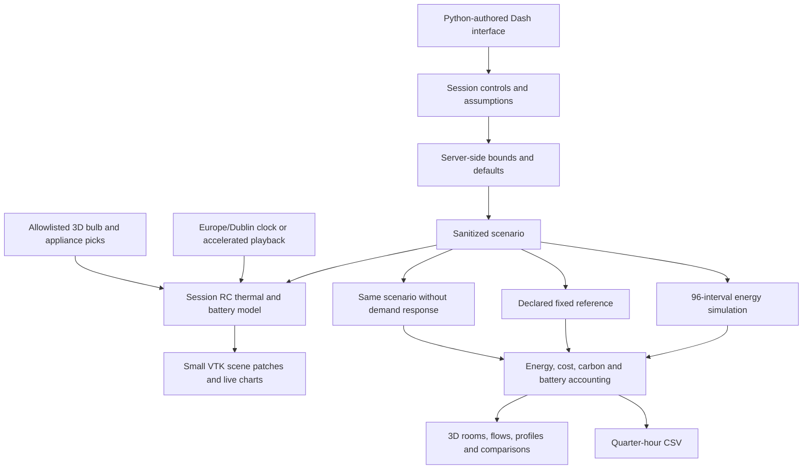
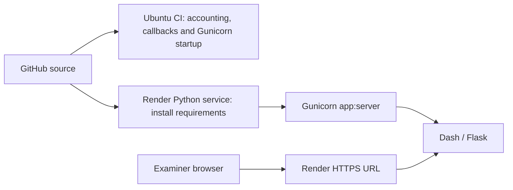

# Architecture

Verdant uses Dash's Python component tree and callbacks, Plotly analytics, and a Python-generated VTK WebGL house. The browser runtime is supplied by the frameworks; no handwritten JavaScript application is required. Dash 2.18.2 and bundled React 16.14.0 are explicitly selected for dash-vtk 0.0.9 compatibility.

## Module boundaries

| Module | Responsibility |
|---|---|
| `ui.py` | Sidebar, six view layouts, controls, cards, local vector icons and metric components |
| `app.py` | Callback wiring, scenario state, derived component values, health endpoint and CSV export |
| `energy.py` | Parameter validation, synthetic weather/PV/load profiles, scheduling, storage dispatch, references and totals |
| `runtime.py` | Irish clock, elapsed model time, room heat balance, live battery integration, manual appliance overrides and session counters |
| `house_scene.py` | Complete envelope/roof, furnished interior, rooftop PV, EV/charger/battery, pickable bulb/appliance symbols, camera presets and efficient scene patches |
| `charts.py` | Reusable Plotly figures; no independent accounting formulas |
| `assets/style.css`, `assets/interactive.css` | Local theme, responsive layouts, clock, focus states, viewer and direct controls |

## Interval computation

1. Generate synthetic outdoor conditions and available PV.
2. Build room lighting profiles and estimate heat-pump electrical input.
3. Place enabled appliance cycles in their daily windows; optionally search all contiguous starts for the lowest import-tariff cost.
4. Sum end-use demand.
5. Dispatch battery against solar surplus/demand, enforcing state, power and conversion limits.
6. Calculate the residual grid import or export.
7. Accumulate energy, net electricity cost and assumed operational carbon.
8. Evaluate the reference and matched no-DR counterfactual for comparison.

`evaluate()` caches deterministic results by sanitized scenario and synthetic-day offset. A bounded cache improves chart updates. Callbacks treat cached arrays as read-only. Each visitor's controls are held in a memory-backed `dcc.Store`; there is no shared mutable household controller or persistence layer.

## Live simulation and direct controls

`runtime.step()` samples the daily outdoor/PV/schedule profiles at the model time, applies live appliance overrides, computes thermostat feedback, dispatches the battery, and advances an area-based room RC heat balance. It returns instantaneous kW, room temperatures, room demand, battery kWh, rolling samples and session energy/cost/carbon. The same power balance and battery limits apply to live and daily calculations. Live numerical integration is approximate; the daily projection remains a separate schedule-based calculation.

The actual header clock always uses timezone-aware `Europe/Dublin` conversion. Live mode can follow Irish wall time, advance at ×300, or hold a selected quarter-hour's conditions. Mode/time jumps, day wraps and inactive gaps over 60 seconds reset live state and counters rather than integrating unobserved long periods. Session counters exclude standing charge and DR rewards. Live manual appliance overrides do not enter daily CSV/reference/DR accounting.

Both house viewers share brightness and appliance state. Only explicit IDs such as `devices:light:living` and `home:device:ev` can change controls. Lighting changes update the real dimmer values and remember the previous dim level; equipment clicks create live On/Off overrides. Clearing consumed `clickInfo` allows repeated clicks at exactly the same location. Accessible room/equipment buttons provide the same controls without 3D picking.

Static meshes are cached and grouped by opacity into a few RGB-colored batches. Full children are sent when a view/envelope changes. Live ticks patch a small particle-point buffer and battery fill; control changes also patch colors, light pools and actor transforms. Camera state is retained. Explicit zoom controls scale the displayed scene consistently, while native VTK orbit, pan and dolly interaction remains available.

The architecture is illustrative: window openings, slate roof, cedar facade, furniture and visible equipment improve spatial clarity, but it is not a surveyed building or photorealistic architectural model. The server generates mesh arrays without importing native VTK's renderer.

## Deployment

One Gunicorn worker and four threads avoid multiplying the in-memory framework footprint on a small instance. `/healthz` is an inexpensive JSON health check. No database or external API is needed. The example configuration selects Render's free plan, whose limits and cold starts are documented in the main README.

## Extension boundaries

Actual meter ingestion, authenticated physical-device control, a persistent database, occupancy sensors, real-time supplier tariffs, weather APIs, multi-day battery optimization, validated building physics and real DR settlement are not implemented. They must replace or extend the simulation explicitly rather than being presented as existing features.

Keep credentials on the server and preserve separation between verified measurements, forecasts and scenario outputs if those capabilities are added.
