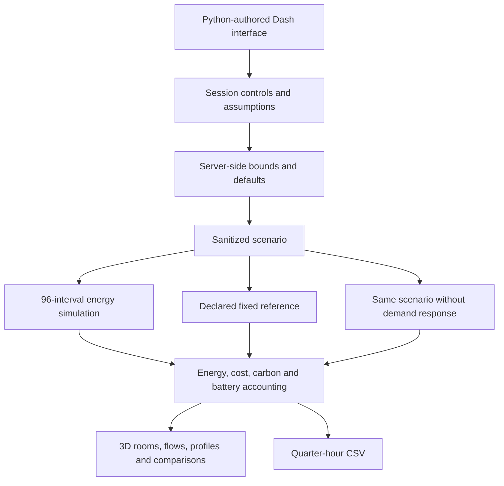
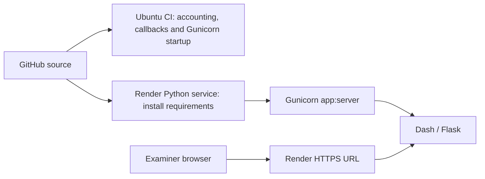

# Architecture

Verdant uses Dash's Python component tree and Python callbacks, with Plotly figures for analytics and the 3D house. The browser runtime is supplied by the frameworks; no handwritten JavaScript application is required.

## Module boundaries

| Module | Responsibility |
|---|---|
| `ui.py` | Sidebar, six view layouts, controls, cards, local vector icons and metric components |
| `app.py` | Callback wiring, scenario state, derived component values, health endpoint and CSV export |
| `energy.py` | Parameter validation, synthetic weather/PV/load profiles, scheduling, storage dispatch, references and totals |
| `house.py` | 3D meshes, furniture, PV canopy, vehicle, room markers, energy/lighting overlays and room selection metadata |
| `charts.py` | Reusable Plotly figures; no independent accounting formulas |
| `assets/style.css` | Local theme, responsive layouts, focus states and framework-control appearance |

## Interval computation

1. Generate synthetic outdoor conditions and available PV.
2. Build room lighting profiles and estimate heat-pump electrical input.
3. Place enabled appliance cycles in their daily windows; optionally search all contiguous starts for the lowest import-tariff cost.
4. Sum end-use demand.
5. Dispatch battery against solar surplus/demand, enforcing state, power and conversion limits.
6. Calculate the residual grid import or export.
7. Accumulate energy, net electricity cost and assumed operational carbon.
8. Evaluate the reference and matched no-DR counterfactual for comparison.

`evaluate()` caches deterministic results by sanitized scenario and synthetic-day offset. A bounded cache improves chart updates. Callbacks treat cached arrays as read-only. Each visitor's controls are held in a memory-backed `dcc.Store`; there is no shared mutable household controller or persistence layer.

## Deployment

One Gunicorn worker and four threads avoid multiplying the in-memory framework footprint on a small instance. `/healthz` is an inexpensive JSON health check. No database or external API is needed. The example configuration selects Render's free plan, whose limits and cold starts are documented in the main README.

## Extension boundaries

Actual meter ingestion, authenticated physical-device control, a persistent database, occupancy sensors, real-time supplier tariffs, weather APIs, multi-day battery optimization, a thermal dynamics model and real DR settlement are not implemented. They must replace or extend the simulation explicitly rather than being presented as existing features.

Keep credentials on the server and preserve separation between verified measurements, forecasts and scenario outputs if those capabilities are added.
